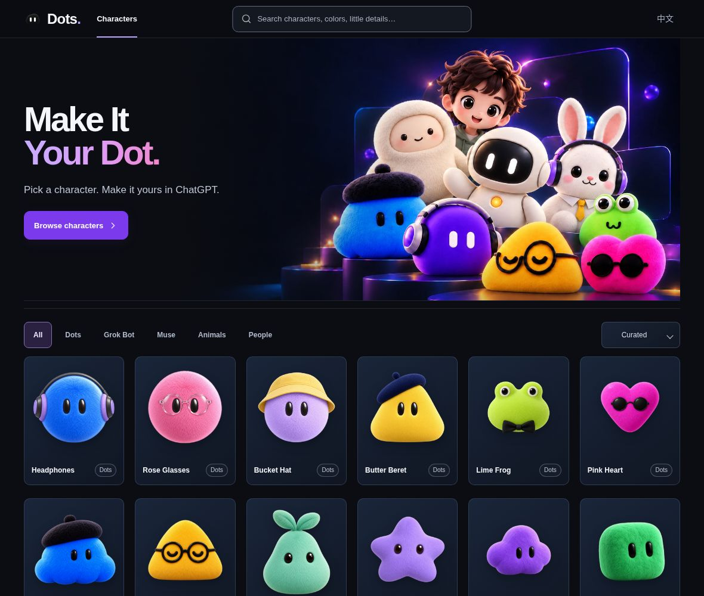

# Dots

**Make It Your Dot.｜创造你的 Dot.**

一个深色主题的角色图库与轻量角色调整工具：选择形象、调整已支持的颜色和细节、复制提示词，再把透明 PNG 带到自己的创作中。

[在线体验](https://dots.liuzhihang.chatgpt.site) · [设计说明](DESIGN.md) · [角色制作指南](design/character-authoring/README.md) · [代码许可](LICENSE) · [素材使用说明](ASSET_LICENSE.md)

> Dots is a static character gallery and a bounded character-customization studio. Browse characters, adjust supported options, copy prompts, and export transparent PNGs. The project is independent and is not an official OpenAI, xAI, or Meta product.

## 产品预览

> 在线演示站桌面首页，采集于 2026-10-12，视口 1180 × 1000；非设计稿，角色与页面会持续更新。

## 可以做什么

- **浏览与筛选**：一个外观对应一个图库形象，云朵等外观可直接选择；按系列筛选或搜索名称与特征词，在统一的 CharacterStudio 中查看。
- **角色调整**：在选定形象上调整实际支持的配色、五官、配饰及适用服装；外观保持固定，只显示有多个合法结果的分类。固定配置的形象仍可复制 Prompt 和导出。
- **透明 PNG 导出**：来源作品的默认形象未修改时下载登记原图；派生形象及修改结果导出当前成功预览的透明 PNG。界面底色不会写进图片。
- **提示词交接**：复制当前 Prompt，或打开 ChatGPT 后由你检查、附图并发送。额外要求只加入提示词，不直接改变本地像素。
- **中英文界面**：支持简体中文与英文，以及响应式布局、键盘操作和减少动效设置。

### 能力边界

这里提供的是已登记素材的有限调整，不是任意图像生成模型。网站不接收或分析用户上传的参考图，不自动发送 ChatGPT 消息，也不提供可直接安装的 Dot/Pet 动画包。PNG 导出、素材权利与目标平台兼容性是不同问题，详见 [素材使用说明](ASSET_LICENSE.md) 和 [目标资源规范](openspec/specs/target-resources/spec.md)。

## 使用流程

1. 在图库里选择喜欢的形象，按系列筛选，或搜索名称与特征词缩小范围。
2. 打开详情，在支持的类别中调整颜色、五官和配饰，查看同步更新的预览与提示词。
3. 导出透明 PNG；或复制 Prompt / 打开 ChatGPT，由你自行附图并继续创作。

本地调整是静态、有限的模板组合。额外要求交给外部创作流程处理，不会被误当成已经应用到本地图片的效果。

基础外观归并方案见 [OpenSpec change](openspec/changes/archive/2026-10-13-move-appearances-into-gallery/design.md)。图库有 83 个基础形象；短绒圆球、三瓣云朵和圆角三角的颜色/配饰来源归入同一形象内。90 个内部来源外观与现有 44 件已批准作品的 540 条合法配方保留，不新增 Artwork 批准记录。当前线上版本及独立验收边界见 [Site 59 / v110 发布记录](design/releases/20261013-option-card-palette-v110/README.md)。

## 为创作保留清楚的边界

- 图片、Prompt 与成功渲染状态保持一致，失败时不伪报完成。
- 预览采用无损 WebP 交付，原图与调整结果仍以 PNG 导出。
- 原图、调整结果、参考素材与动画/安装包分别说明，不把单张图片包装成未实现的平台能力。

## 许可证与素材权利

- **项目自有代码及说明文档**采用 [MIT License](LICENSE)，允许依许可条件使用、修改和分发。
- **角色图像、图层、参考图、原型、截图、品牌标识及其他视觉素材不自动适用代码的 MIT 许可**；范围与处理原则见 [ASSET_LICENSE.md](ASSET_LICENSE.md)。第三方依赖与第三方内容继续遵守各自条款。
- 本项目与 OpenAI、xAI、Meta 及相关角色或商标权利人无官方隶属或背书关系。工程或美术上的“approved”不代表已经取得版权、商标、肖像或商用授权。

公开源码不等于所有随附素材均可自由商用。部署、再分发素材或用于商业项目之前，请核对对应文件的明确授权。

## 开发与贡献

想在本地运行、修改或部署？请阅读 [开发指南](DEVELOPMENT.md)，其中包含环境要求、启动、测试、目录结构、静态发布与贡献流程。

更多资料：[设计说明](DESIGN.md) · [产品规范](openspec/specs/) · [角色制作指南](design/character-authoring/README.md) · [反馈问题](https://github.com/liuzhihang/dots/issues)
