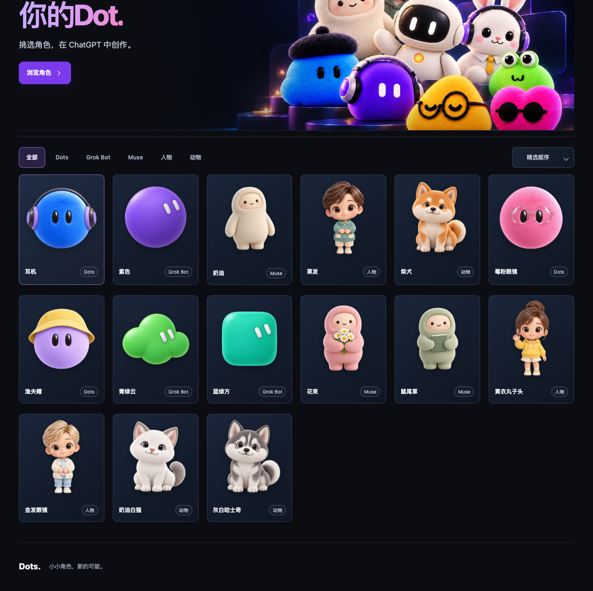
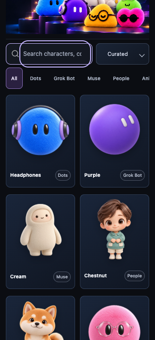

# 2026-10-11 卡片整体性 CR 跟进

用户最终确认：名称靠左，系列标签靠右；图片和底部信息组成一个整体卡片，不呈现两个独立底色，信息行垂直居中并保持均匀上下留白。

运行时仅修改 `dist/studio.css`。移除图片区局部背景，沿用整卡连续背景、一个外框和整个按钮点击区；caption 至少48px，上下 padding 一致，名称和标签垂直中心对齐。没有改素材、渲染、Prompt、模板能力或 pending 状态。

验收：`npm run build` 和 `git diff --check` 通过；OpenSpec strict 通过；现有首页专项10个视口/语言组合通过、无页面错误。Codex IAB 实页刷新已回读15张卡片：信息区48px，上下留白约13px，标签距右边12px。补充项目 Playwright 检查1261px中文、390px中文及320px英文，三组全部15件卡的名称/标签中心差均0，上下留白差最大0.016px；截图和 `card-geometry.json` 保留。Browser plugin 未提供，自动化沿用项目现有 Playwright + 已安装 Chrome；IAB 用于实际页面视觉确认。

在三个视口实际点开 Muse 的奶油作品，均为静态详情，复制Prompt、在ChatGPT使用和导出可见，编辑区不显示。注册表只包含精确绑定前两件基准作品的 Dots/Grok 两套 pending 试点模板，本地审阅 harness 可测；其他作品没有分层模板。后续扩展需要分别制作主体/眼型/配饰等真实图层和遮挡适配，并绑定作品版本；没有“下一期已经排期”的记录。

本次未重复28配方/全部下载等未受CSS影响的检查，相关通过证据见前一轮 [CR](../cr-polish-20261011/README.md)。全部素材字节保持不变；本轮构建155文件hash与更新后的 approval scope 一致。仅本地更新，未提交、推送或发布，用户美术确认和实体设备验收未完成。

