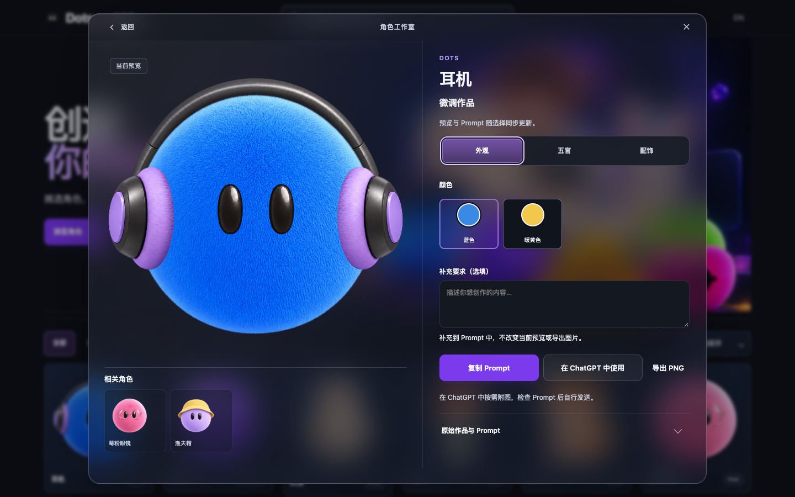
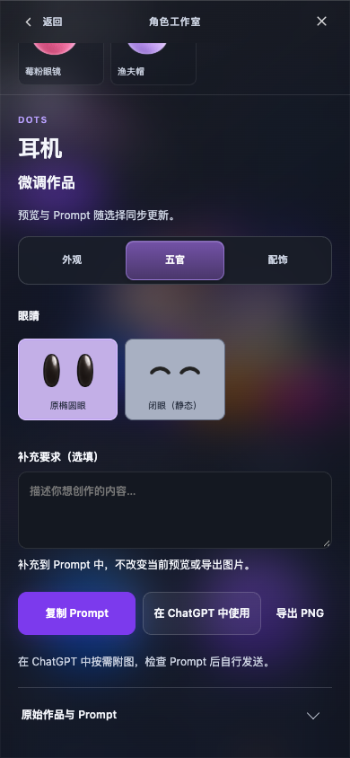

# 2026-10-11 本地 CR：分类、名称与玻璃面板精修

本轮只做本地实现和验证。没有提交、推送、Sites 保存或部署。素材、模板、Hero 插画的 pending/公开资格不变，OpenSpec 7.4 用户美术确认仍未完成。

## 已实现

- 一级分类按外观、五官、服装、配饰、物品组织。形状/配色归外观，眼睛归五官，帽子/眼镜/耳机/首饰归配饰，电脑/书本等归物品。当前模板只显示有真实选项的外观、五官、配饰三类；服装、物品及更多子项等待真实适配资源，不显示空分类或虚构选项。现有 option key、12+16 配方及渲染器不变。
- 中文页面标题精确为 `创造你的Dot.`，Hero 为“创造”/“你的Dot.”，短介绍为“挑选角色，在 ChatGPT 中创作。”。删除首页通用 Copy Dots Prompt 按钮，只保留浏览角色入口；英文同样精简。
- Muse 系列展示名统一为 Muse，24 件已登记作品双语标题去掉重复系列后缀。名称旁同排显示描边系列标签，窄屏允许自然换行；系列/角色 ID、事实、原 Prompt、描述与素材不变。
- 玻璃详情头部收薄为 48px（不含设备安全区），去掉独立背景及分隔线，操作命中区域仍至少 44px；相关角色紧凑左对齐。
- “微调作品”及“预览与 Prompt 随选择同步更新。”；移除冗长审阅句和固定形状说明。Pending 资格保留在元数据及外部 harness。
- Copy Prompt 和 ChatGPT 为主要操作，Export 为紧凑次级操作。眼型用真实透明图层，整张卡片采用浅烟紫实底，不再有内部灰方块。CSS 几何箭头替代偏移的字符圆圈。

## 实际验证

| 检查 | 结果与证据 |
| --- | --- |
| 核心套件 | `npm test` 通过；见 `tests/npm-test.log` |
| 配方与完整编辑 | `npm run test:editing` 通过，全部 28 配方、两套 Prompt/实际 PNG 导出旅程、dirty guard、异步竞态；见 `tests/test-editing.log` 与 `editing/run-2026-10-10T16-24-04-515Z/report.json` |
| 浏览器行为 | `verify-studio-browser` 通过：18 项、21 张截图、24 次原图原字节下载；见 `tests/test-browser.log` 开头与 `browser/` |
| 首页 | 10 个双语/视口组合通过；见 `tests/home-hero.log` |
| 最终对比度 | 258 个文字目标，0 失败。普通文字至少 4.5:1；最低 3.49:1 来自按 3:1 验证的渐变大字。见 `contrast/final/contrast.json` |
| 最终编辑布局 | 24 案例、40 张截图；覆盖 1440×900、1206×1257、768×1024、390×844、320×700 双语、完整预览、三类 tabs/键盘、无空分类、操作命中、无 blur/降低透明度等。见 `editor-layout/final/layout.json` |
| 构建和保护 | 最终 `npm run build`、`git diff --check` 通过；155 个活动文件，15 approved/9 pending Artwork，6962 历史基线 hash 保留；见 `commands/build-complete.log`、`build-report.json` 和 `source-delta.json` |
| OpenSpec | strict validation 通过，见 `commands/openspec-strict.log` |

首轮 `npm run test:browser` 聚合命令在浏览器行为子套件通过后，因真实对比度缺陷退出 1。修复 Export 与玻璃次级文字颜色后，contrast 独立复验通过；手机 header 内边距缺陷修复后，layout 独立复验通过。没有把首轮聚合失败标成通过，也没有重复已通过的浏览器行为子套件。旧验证器的 tabpanel/class、CSS computed margin 和图标中心假设已按新 DOM 修正，阈值没有降低。失败日志保留于 `tests/`，最终报告在 `final/`。

根代理在 Codex 实际本地浏览器刷新并查看了首页、详情和五官 tab，并人工查看最终 1440px、390px 与 320px 截图；上述自动化来自项目 Playwright + 已安装 Chrome。没有实体手机验证。工程和浏览器结果不代表用户美术确认。

所有 `dist/assets/` 资源字节及四个受保护配置文件不变；28 张配方输出 SHA 与原 approval scope 逐项一致。`approval-scope.json` 只更新显示名、页面源 hash 与最新证据指针，状态仍为 pending。

## 复查入口

- 首页：<http://127.0.0.1:5182/__dots_review__/#/>
- Dots 模板：<http://127.0.0.1:5182/__dots_review__/#/artwork/candidate-dots-20261005?v=v2>
- Grok 模板：<http://127.0.0.1:5182/__dots_review__/#/artwork/candidate-grok-20261005?v=v2>

