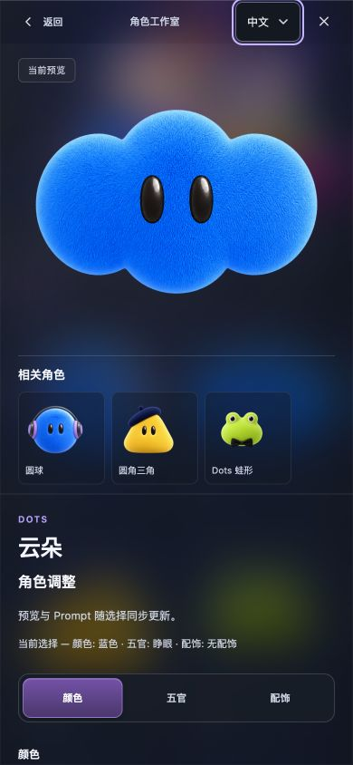

# 基础形象图库与紧凑下拉 v103

[生产站点](https://dots.liuzhihang.chatgpt.site) 已发布为 Site 52 / v103，部署状态 `succeeded`。用户明确要求检查下拉样式，修复后发布到现有 dots 项目供验收；保留原 public 受众。

本次下拉按当前选中文字收缩宽度，同时移除窄屏排序固定列宽及详情语言框的104px覆盖。中文语言框由108px收紧到72px，中文精选排序由132px收紧到96px；文字至箭头约10px，高度保持44px。英文及短排序标签会按实际长度调整。该调整同时适用于图库与详情。

图库采用83个基础形象，内部90个来源Look、44件原Artwork/Template及540条真实配方继续保留。三瓣短绒云朵等同外观的颜色/五官/配饰归在形象内，旧精确来源链接保持可访问。所有原素材与批准记录不因本次发布改写。

## 发布闭包

仓库dist保留1004个文件；按 `design/static-publish-manifest.json` 生成独立592文件发布目录，412个source-only PNG留在源码。Sites包含592个应用文件和1个hosting metadata，全部应用字节及SHA-256与冻结目录一致，无AppleDouble文件，详见 [publish-closure.json](publish-closure.json) 与 [package-verification.json](package-verification.json)。

线上回读覆盖本次相对Site51新增或修改的116条路径：115条原始响应字节/hash精确匹配；index.html的响应由Cloudflare在最终body结束前追加938字节脚本，隔离该平台插入后发布源HTML精确匹配。另有7张未变原图的线上hash抽样，详见 [线上回读摘要](http-changed-readback-reconciliation.json) 与 [HTML平台插入审计](index-edge-append-audit.json)。592项完整包hash核对与本次线上变更范围回读分别记录。

用户工作仓库HEAD仍为 `7ca4afa7f2f732e17f8687fb0839dc73d1467059`，本轮没有GitHub提交或推送；Sites helper仅在隔离的专用Sites源仓库保存并推送 `c1a4e803dbf62f3b3361e4564ba5ddbfaa057f5c`，据此保存Site52并部署。详见 [原生回执](site-native-result.json)。

## 验证

- 18组布局、30次控件量测覆盖1280/390/320px、中文/English、Curated/Name及详情语言控件，间距10.0–10.01px，44px高度，选中标签完整且无溢出。实际原生菜单与键盘在内置Browser验证；headless只验证Tab焦点，不冒充操作系统菜单证据。
- 首次npm test在headless原生菜单键盘等待处超时。修正harness并去除实测发现的详情窄屏固定宽度后，select及后续全部必需检查串行通过；前段此前已通过。工程检查包含83形象/90来源、540真实配方、审批/原图hash、路由、历史恢复、编辑/渲染与资源边界；构建、release-safety及OpenSpec严格校验通过。详见 [本地验证摘要](local-qa-summary.json)，原始失败和续跑日志均保留在 `.artifacts/compact-select-publish-20261013/`。
- 线上内置Browser确认v103及83张卡片，Dots云朵筛选只有1张；原生语言和排序选择实际生效，320/390窄屏控件可用。浅紫云朵跨来源换色、玫瑰粉圆框眼镜、外部要求保留、复制Prompt、修改后无弹窗关闭与筛选恢复均已观察。控制台无warning/error，详见 [线上交互记录](production-browser.json)。
- 线上实际下载两张1254×1254 RGBA透明PNG，其SHA-256分别匹配原登记配方基线，真实透明像素分别841393和842317，不将UI背景写入结果，详见 [PNG复验](production-png-proof.json)。

工程、实际Browser、Sites部署与PNG分别留证。没有新增美术审批；真实手机设备、ChatGPT发送/生图未作为本轮已验证项目。现有OpenSpec change已记录本阶段，不进行sync/archive。
