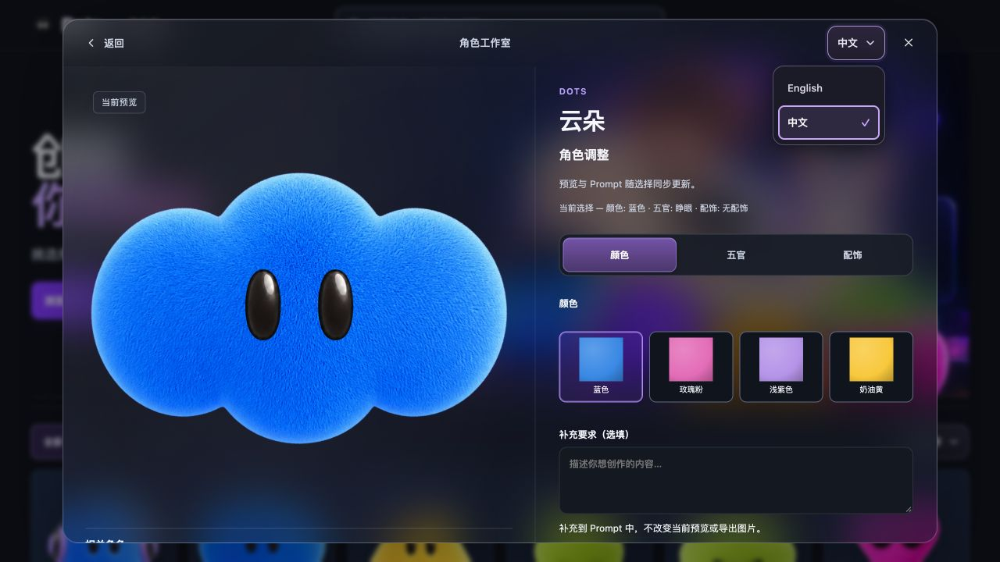
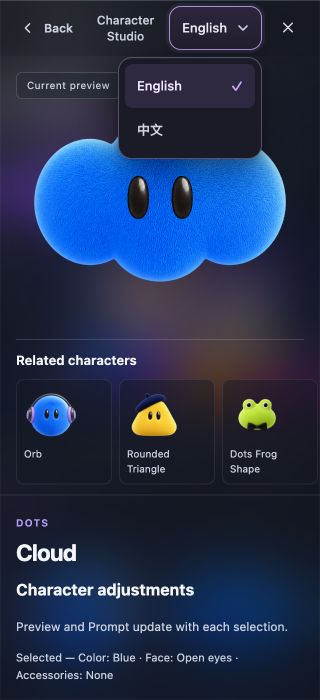
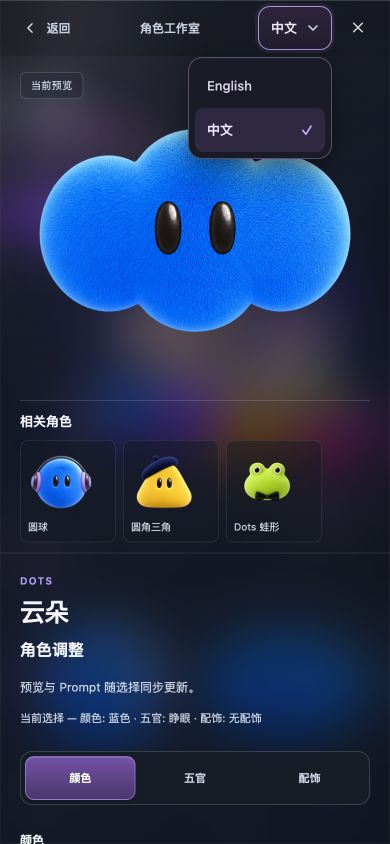

# 下拉菜单与弹窗语言控件 v105

[Dots 生产站点](https://dots.liuzhihang.chatgpt.site) 已更新到 Site 54 / v105，部署状态 `succeeded`。本次按用户反馈优化语言、排序下拉与弹窗顶部比例，保留既有 public 受众。

语言与排序按钮统一为深色表面、12px圆角、柔和边框和清楚的焦点状态，宽度随文字收紧，文字到箭头约10px。支持原生可定制select的浏览器展开深色菜单，当前项有淡紫底和勾选；旧浏览器保留系统菜单。渐进增强依据 [MDN customizable select](https://developer.mozilla.org/en-US/docs/Learn_web_development/Extensions/Forms/Customizable_select)。

弹窗语言文字统一13px、点击高度44px。顶部上下留白桌面8px、窄屏6px，标题和返回文字为13px/12px；320px英文标题允许两行。线上复验发现中文“返回”受旧18px内边距挤压换行后，进一步改为桌面12px、窄屏6px水平内距并保持单行，最终返回、语言和关闭按钮均为44px高。对应文本行高和按钮等高检查已加入回归脚本。

## 验证与边界

- 最终v105构建通过：1004个源码文件、44个批准Artwork、0待批准。相关恢复检查通过，44个Template、540条配方未变；本轮早先还通过router、runtime、发布清单和release-safety检查。本轮没有重新执行完整npm test，详见 [本地验证](local-qa-summary.json)。
- 自动量测覆盖18组状态、30个控件、6组双语弹窗标题栏，包含1280/390/320px。真实选择、键盘、Escape顺序与模拟旧CSS回退通过。模拟回退不代表实测Safari/Firefox。
- 内置Browser实际观察线上v105：桌面中文返回单行，320px英文与390px中文菜单均在视口内；语言切换、排序、换色、修改后无确认关闭和语言控件归位通过。页面warning/error为空，详见 [线上交互](production-browser.json)。
- 线上实际导出浅紫云朵PNG为1254×1254 RGBA，含841393个完全透明像素，SHA-256与原登记配方一致，详见 [PNG证据](production-png-proof.json)。
- 未做真实手机设备、实际Safari/Firefox菜单或ChatGPT发送/生图验收，也没有新增美术审批。

## 发布与保护

按 `design/static-publish-manifest.json` 精确生成592文件、238537027字节的发布目录；412个source-only PNG留在源码。发布包含592个应用文件及1个hosting metadata，所有应用hash均匹配，无AppleDouble文件。详见 [包校验](package-verification.json)。

线上回读覆盖相对本轮基线改动的22个runtime文件：21项原始HTTP字节及hash精确匹配；index.html经托管层追加938字节脚本，隔离仅该追加后源HTML逐字节匹配。没有把全部592项的包校验称作全站HTTP校验，详见 [线上回读](http-readback.json)。

批准素材及保护配置未改，运行时JS仅更新缓存版本引用。用户仓库HEAD仍为 `7ca4afa7f2f732e17f8687fb0839dc73d1467059`（PR #4此前已合并），本次没有GitHub提交/推送。Sites专用源仓库由官方helper保存并推送 `7901afc139526e32523d06d8150a049d5bfa1d80`，据此部署Site54，详见 [原生发布回执](site-native-result.json) 与 [源码保护核对](source-readback.json)。OpenSpec阶段7完成，不进行主规范同步或归档。

原始过程记录保存在 `.artifacts/select-polish-20261013/`；最终证据位于其 `v105/` 子目录，保留v104问题及修复过程。
