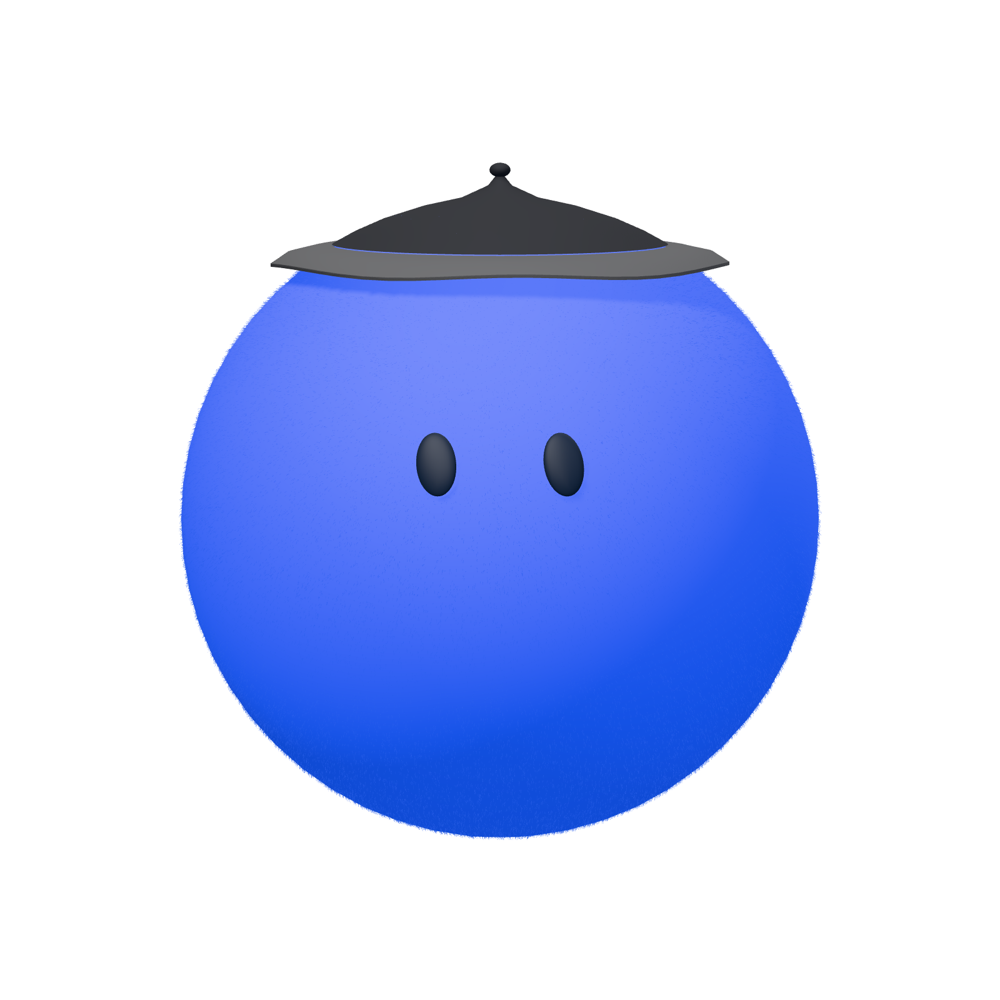
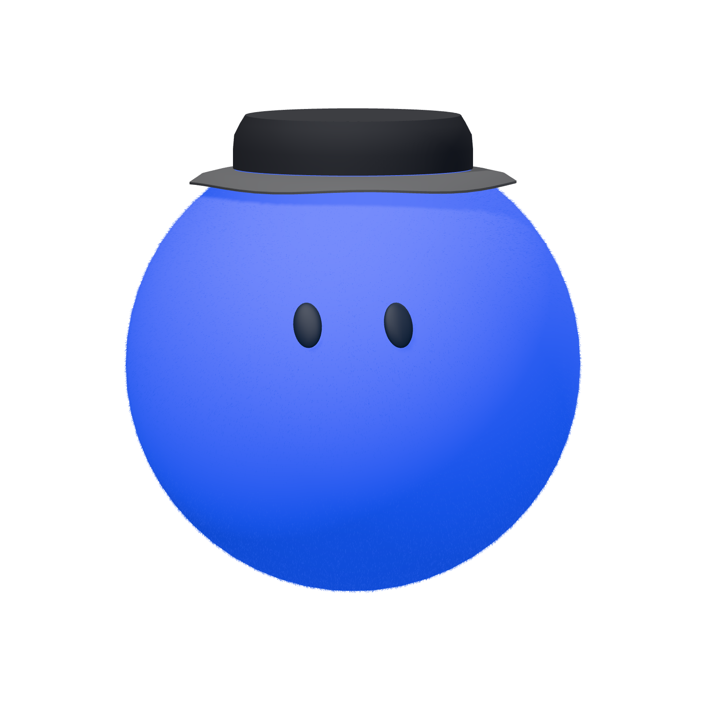

# v70 代表图与修正过程记录

本目录保存角色代表图、下载清单及修正前后的独立证据。**最终冻结矩阵只认 v70 `sourceId=9181d019add9fe9892dc4af770d85650ee99bc52b9bcb3db755ad0979d961826`；本目录有一组旧 draft 相机修复样张，不能把整个旧 draft 当作最终源码或最终美术通过。** 所有样张目前都未获用户美术批准。

## 源版本与证据范围

| 证据组 | 来源 | 实际下载与范围 | 可支持的结论 |
| --- | --- | --- | --- |
| 首次 draft | [`draft-source.json`](draft-source.json)，sourceId `462d2cc36d68f6348c0f76f2a9eb9548278dd7559324002d1c9bc211f5a87dd0` | [`actual-downloads.json`](actual-downloads.json) 共 36 条：27 张 WebGL、9 张 software/CPU；相机修复独立样张为 15 张 WebGL + 9 张 CPU。9 张 CPU 中，7 张是相机动作 PNG，另外 2 张是 Muse 眼镜侧视 PNG。 | 这批实际图像被独立检查；相机修复 review 认为角色下半脸被遮住的硬伤已经修复。CPU 相机动作只有 Muse 覆盖正面/四分之三/侧面，其余四组仅正面，不能推出 CPU 所有视角都通过。462d 的整体版本仍有 Dots 桶帽像锥体、Muse 镜腿埋入头罩等问题。 |
| 修订后的 v70 代表图 | [`draft-source-revised.json`](draft-source-revised.json)，sourceId `9181d019add9fe9892dc4af770d85650ee99bc52b9bcb3db755ad0979d961826` | [`revised-actual-downloads.json`](revised-actual-downloads.json) 12 张 WebGL；[`revised-cpu-actual-downloads.json`](revised-cpu-actual-downloads.json) 2 张 CPU。14 个对应实际下载 PNG 均在本目录。 | WebGL 是 Muse 圆脸/方脸正面、四分之三、侧面，Dots 桶帽三视角和 Grok 桶帽三视角；CPU 只有 Muse 圆脸/方脸侧视图。相关记录的 sourceId 与最终 v70 一致。它们证明这些配置确实被页面渲染并下载，样本量不构成其余家族、动作或 CPU/WebGL 完整一致性的证明。 |

462d 与 v70 使用同一 baseline commit，但 sourceId 不同；相关相机改动在这两版之间保持一致。因此 462d 的相机样张可以作为这一局部修复的独立观测，不能替代 v70 的完整冻结矩阵或扩展为整个 462d 版本通过。最终全矩阵及 source inventory 见 [v70 冻结矩阵 README](../current-20261005-v70/README.md)、[source snapshot](../current-20261005-v70/source-snapshot.json) 和 [矩阵 raw index](../current-20261005-v70/frames/raw-source-index.json)。

## 图像对照

Dots 桶帽从首次 draft 的尖锥形读法改为更清楚的帽檐轮廓；这只说明特定代表图经过修订，不是用户确认。

| 首次 draft 462d | 修订后 v70 |
| --- | --- |
|  |  |

Meta Muse 修订后的侧视代表图可见镜腿从头罩侧面延伸至脸侧；请勿据单一侧视图推断所有镜架或全部视角的接触关系都已验收。

| 首次 draft 462d | 修订后 v70 |
| --- | --- |
|  |  |

## 相机样张的具体覆盖

462d 的 15 张 WebGL 相机动作 PNG 为：

- Dots：`dots-172` 正面、`dots-175` 四分之三、`dots-178` 侧面。
- Grok Bot：`grok-172` 正面、`grok-175` 四分之三、`grok-178` 侧面。
- Meta Muse：`meta-muse-172` 正面、`meta-muse-175` 四分之三、`meta-muse-178` 侧面。
- 人物：`humans-172` 正面、`humans-175` 四分之三、`humans-178` 侧面。
- 动物：`animals-172` 正面、`animals-175` 四分之三、`animals-178` 侧面。

9 张 CPU 样张是 7 张动作相机图：Muse `172/175/178` 三视角，Dots/Grok/人物/动物各自仅 `172` 正面；另有 Muse 镜腿侧视 `meta-muse-057`、`meta-muse-060` 两张。相关原始代表 PNG、截图与每张 JSON report 均以对应 ID 保存在本目录。

v70 的 `frames/` 全矩阵包含 WebGL 和 CPU 的相机 case；最终 source 和 case 输出以其冻结矩阵为准，不将早期代表图混入全矩阵证据。网页主路径响应式、实际 main/diagnostic PNG 与剪贴板 evidence 汇总见 [v70 current README](../current-20261005-v70/README.md)。

## 尚未通过的门槛

- 五组角色均未通过美术验收、用户没有逐组批准；任何代表图都不解锁该组后续候选。
- 仍需对身份可辨识度、近看材质、缩小后的轮廓、比例端点、发层/毛面、配饰接触和遮挡、手持物承托、动作关键帧、背景与导出构图做真实网页人工检查。
- 两条渲染路径、完整视角/动作和每种配饰之间仍要按 tasks.md 中未完成门槛逐项检查。浏览器 viewport 截图不能代替实体手机验收。
- 人物与动物必须是原创设计，不能把动漫截屏做成运行时图、贴图或可识别的完整角色复刻。

PNG 是被实际下载的页面输出，报告记录其当时设置与 sourceId。下载成功、静态矩阵完整、截图、文件尺寸/alpha、Prompt 剪贴板一致、构建和任务勾选都不能单独或合并推导出美术通过。
