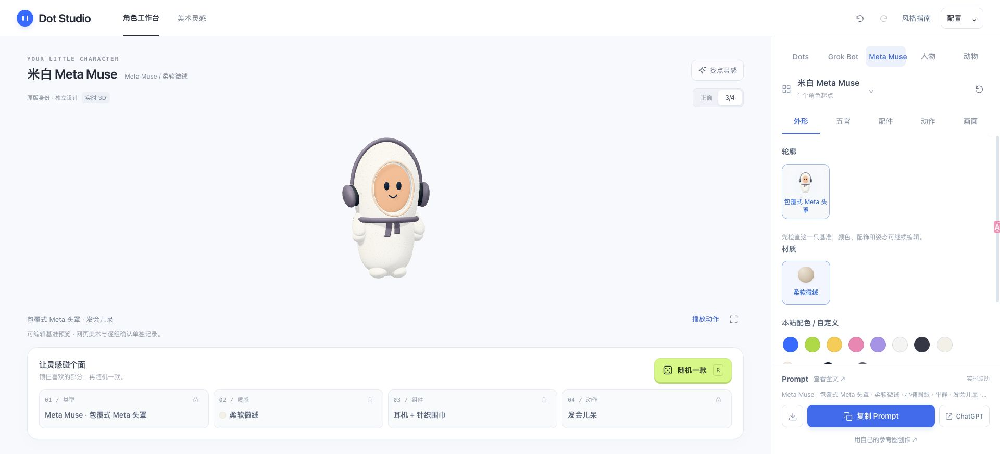

# 当前候选验收记录

2026-10-05：**五组当前程序化候选均未通过美术验收，用户已明确否决外观，不允许扩展。** 业务微调已暂停，推荐的整图＋组合资产方案见 [资产路线复审](../asset-route-review.md)。本目录是失败诊断与部分工程证据，不是成品批准包。

本机页面：`http://127.0.0.1:5173/`；CPU 路径：`?renderer=software`。原站保持 v27，没有保存 Sites 新版本或发布；未执行实体手机验收。本机 localhost 不代表跨网络手机可访问。

## 独立状态

| 分组 | 候选 / 已有页面证据 | 主要失败或未确认项 | 网页美术 / 用户确认 / 扩展 |
| --- | --- | --- | --- |
| Dots | 一只蓝色圆体；裸形/耳机三视角、比例端点与帽镜组合 | 绒面出现刷毛条纹与黑点，正常尺寸缺精细柔软感；响应式/CPU/完整动作与剪贴板最终矩阵缺证 | 未通过 / 未批准 / 禁止 |
| Grok Bot | 一只淡紫软拱；裸形/组合三视角、比例、320/390/768 px、CPU 正侧面；六状态×点列/液滴的起中末和减少动态留证 | 电脑在正面遮住承托位置；Prompt 回读文件为空，不能报复制通过；CPU PNG与最终一致性缺证 | 未通过 / 未批准 / 禁止 |
| Meta Muse | 一只米白包覆体；开口/凹面修正，三视角、比例和帽镜；较早视口与 CPU 诊断 | 用户截图出现脸面交错；后续开口和内缘修正不等于整体精细度通过；完整最终矩阵缺证 | 未通过 / 未批准 / 禁止 |
| 人物 | 一只原创栗色短发；裸形/耳机读书三视角、比例和帽镜；17 开放动作暂停帧 | 与 R01 的精细人物差距仍需重新制作；完整响应式/CPU/动作关键帧最终矩阵缺证 | 未通过 / 未批准 / 禁止 |
| 动物 | 一只原创柴犬；三视角、比例、17动作暂停帧、320/390/768 px 与 CPU 正侧面 | 毛面仍有颗粒，色区边缘与道具层次需细化；CPU PNG/完整关键帧最终矩阵缺证 | 未通过 / 未批准 / 禁止 |

人物/动物通过自制几何实现，没有使用动漫截图作为运行角色图或贴图；这只证明素材使用边界，不代表艺术质量通过。所有原会话参考保持在 references 下，用于分析。

## 工程证据与限制

- 57 个冻结历史预设、24 个 schema 6–9 迁移样本验证通过；新五组与 legacy 分离。实际页面导入旧 Muse/Pets、再导出 JSON、撤销，恢复语义已检查，文件见 `evidence/actual-schema-9-*.json` 和 `core-flows.json`。
- `npm ci`、`npm run build`、四个 verify 脚本与 OpenSpec strict validation 已实际执行。62 项预设/状态旅程、468 项来源/迁移断言、7 项随机锁定检查通过；最终字符系统校验包含索引、有限坐标和 200 个单基准随机结果。程序通过不改变上述五组美术状态。
- Node 几何审计覆盖 85 个角色/动作组合、255 个姿势样本；对应文件保存命令与源码 SHA。该审计发生在最后 Meta 内缘局部调整前，是诊断版本，不能称为最终全部画面通过。
- 五组 WebGL PNG 均来自页面实际点击并写入下载目录，留存文件为 1400×1400 RGBA、四角 alpha 为 0。实际文件 SHA、尺寸与边界见 `evidence/downloaded-png-analysis.json`；这些是中间候选。未完成五组 CPU PNG 下载及最终双路径一致性。
- 部分 Prompt 文本已有回读；Grok 回读为空，其他文本尚未与最终版本逐字比较，不报告五组剪贴板全通过。参考图流程仅为文字要求、复制和打开空白 ChatGPT；没有发送 Prompt、上传图片或自动生成。
- 页面的五组选取、单基准目录、legacy 恢复、现有随机锁定/取消和灵感入口实际操作记录在 `evidence/core-flows.json`、`inspiration.json`。分类导航与全屏随机尚未改造，后续独立 change 为 `refactor-family-navigation`、`add-fullscreen-randomizer`。

## 版本与截图语义

`candidate-source.json` 固定当前诊断候选的源码 SHA。`evidence/screens/handoff-meta-muse-current.jpg` 是针对该完整源码快照保存的实际页面截图，canvas 为 WebGL、ready，配置/实际渲染 revision 一致。页面已渲染不等于美术通过。

`evidence/observed.json` 是连续操作日志，含页面 URL、时间、配置、canvas 数据与实际视口。其余截图和 PNG 来自多个中间候选，保留为修正过程诊断；不能把它们拼成当前最终源码的完整验收矩阵。同名截图文件只代表最后留存画面；早期操作日志不会凭空增加一份图片。标签曾写 320 但实际视口为 1920 的尝试不得算手机视口证据；判断必须使用记录中的真实 viewport。

用户否决的两张图片原样保存在 `user-rejection/`；它们不是角色资产，也不会进入 `dist`。逐组记录见 [Dots](dots.md)、[Grok Bot](grok.md)、[Meta Muse](meta-muse.md)、[人物](humans.md)、[动物](animals.md)。
